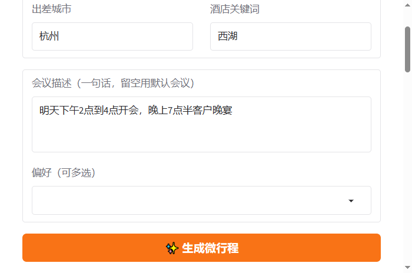
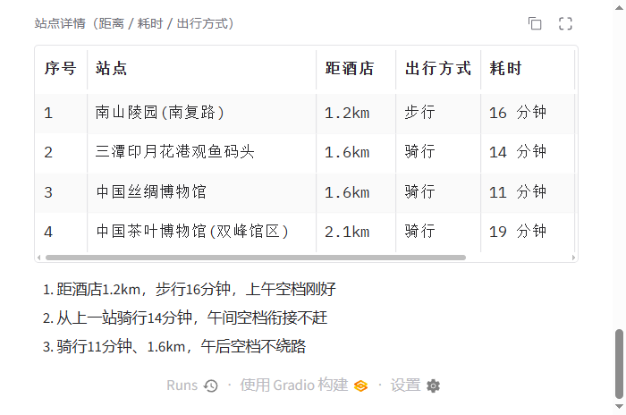

# 商旅融合行程官 · bleisure-planner

2026 飞猪 AI 旅行创新大赛参赛作品：一句话输入出差城市 + 会议时段，Agent 在会议间隙塞入最优微行程——带薪旅行，不耽误正事。

**链路**：flyai 真实数据 → 空间感知选点 → 交通感知规划 → 百炼文案/推荐理由 → 行程卡。

## 运行

```bash
cd bleisure-planner
npm i -g @fly-ai/flyai-cli   # 只需一次
python3 demo.py              # 命令行版：按提示输入会议描述和偏好
python3 app.py               # 网页版：浏览器打开打印出的本地链接（需 pip install gradio）
```

网页版在线 Demo 示例：

| 输入表单 | 行程卡 + 站点详情 + 推荐理由 |
|---|---|
|  |  |

环境变量（只放环境变量，不要写进代码或提交到仓库）：

| 变量 | 说明 |
|---|---|
| `FLYAI_API_KEY` | 飞猪 Key；设置后酒店价格不再脱敏 |
| `DASHSCOPE_API_KEY` | 百炼 Key（sk- 开头）；设置后文案走百炼真实生成，否则本地模板兜底 |
| `QWEN_MODEL` | 使用的千问模型，默认 qwen-plus；换成你免费额度最多的那个（支持 `QWEN_MODELS` 逗号分隔多模型自动回退） |

配好 Key 后先跑烟雾测试，确认百炼链路是通的：

```bash
python3 bailian_smoke.py
```

## 文件

| 文件 | 作用 |
|---|---|
| `demo.py` | 命令行 demo：会议描述 + 偏好输入 → 行程卡 |
| `app.py` | Gradio 网页版：表单输入 → 行程卡 Markdown 渲染 |
| `natural.py` | 一句话会议解析：自然语言 → 结构化会议列表（百炼） |
| `flyai_client.py` | flyai CLI 薄封装：search-poi / search-hotel；多路抓取 + 按名去重 + 偏好排序 |
| `planner.py` | 会议→空闲窗口反推、交通感知的贪心排站、偏好加权、降级话术 |
| `transport.py` | 两点间交通时间估算：按距离自动选步行/骑行/地铁/打车 |
| `geo.py` | haversine 距离 + 按酒店位置排序 POI（空间感知核心） |
| `llm.py` | 百炼调用：开场白生成 + 行程推荐理由；多模型自动回退，无 Key 时本地兜底 |
| `bailian_smoke.py` | 百炼 Key 烟雾测试：验证 Key 与模型是否调通 |
| `tests/` | 单元测试 |
| `docs/` | 网页版在线 Demo 示例截图 |
| `SUBMIT.md` | 官方提交 issue 草稿（含必填"百炼使用说明"） |

## 测试

```bash
python3 -m unittest discover tests -v
```

## 提交

- 演示视频：录 2 分钟（会议描述输入 → 行程卡输出全流程）
- 提交材料草稿见 `SUBMIT.md`，按官方 issue 模板填好后去官方仓库提 Issue
- 提交前检查：`demo_output.md` 是最新运行产物；代码里没有硬编码 Key
