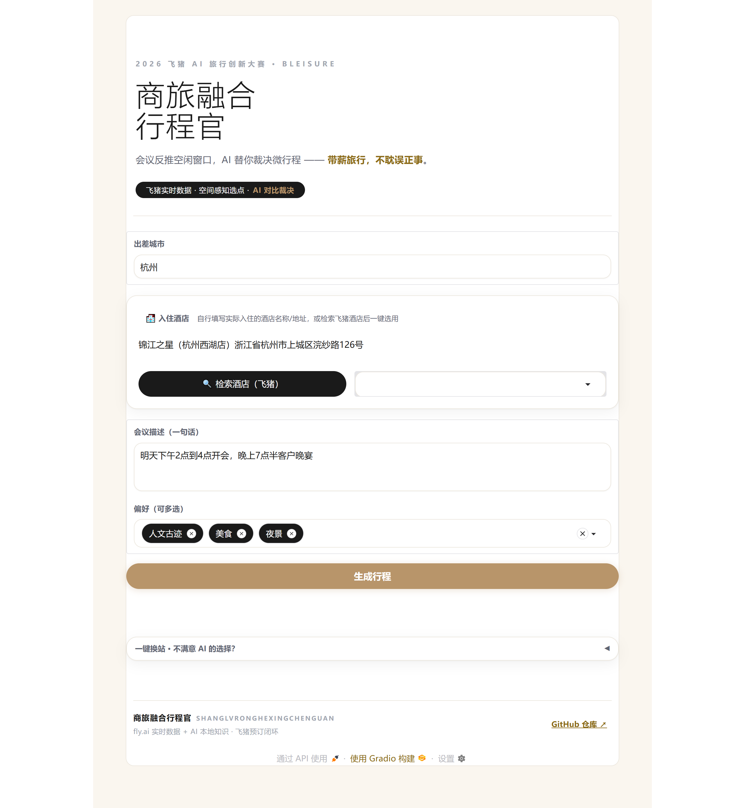
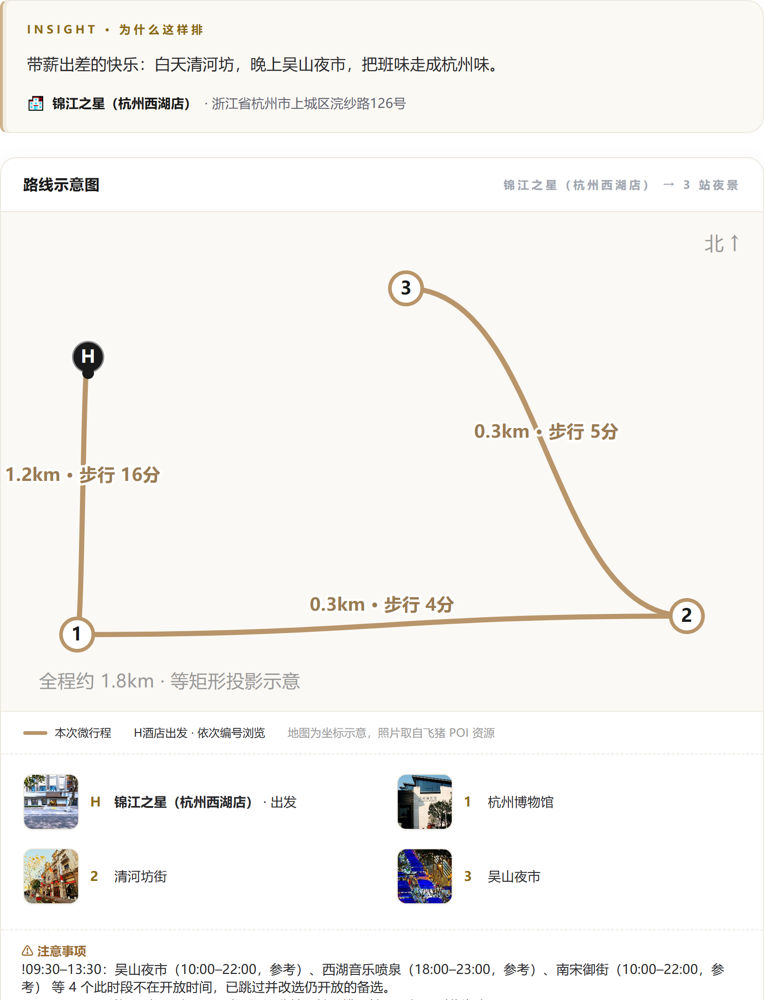
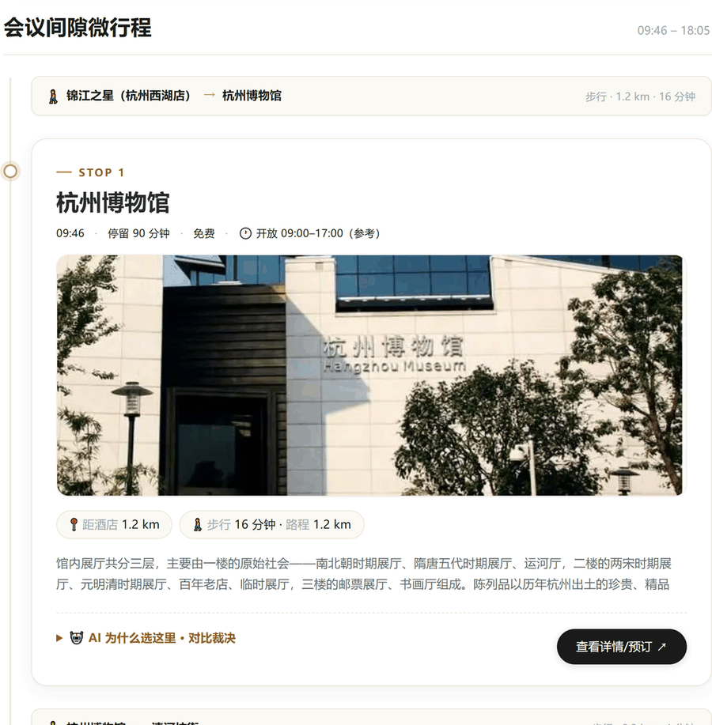
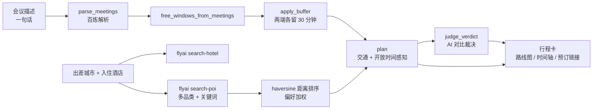

# 商旅融合行程官 · bleisure-planner

> 2026 飞猪 AI 旅行创新大赛参赛作品

一句话说清出差会议安排，Agent 把会议之间的空档变成一条可执行的微行程——**带薪旅行，不耽误正事。**



---

## 为什么要做这件事

出差到陌生城市，白天被会议占满，真正能自由支配的往往只有会议之间的两三个小时。临时查攻略、算路程、比距离，很容易把时间耗在路上，最后哪儿也没去成。

商旅融合行程官把这段碎片时间当成一个约束求解问题：**先用会议反推可用的空闲窗口，再在窗口内挑出"距离近、交通快、当下开放"的地点，排成一条能走完的路线。**

## 效果预览

**结果态总览**：路线草图、站点编号与全程里程，「注意事项」逐条说明降级原因与处理方式。



**时间轴站点卡**：每站给出时间段、停留时长、是否免费、开放时段、距酒店距离、交通方式与耗时、简介、AI 对比裁决，以及飞猪详情/预订入口。



**移动端**：自动收窄为单列全宽，无横向滚动。


## 核心能力

| 能力 | 说明 |
|---|---|
| 一句话会议解析 | 中文口语（"明天下午2点到4点开会，晚上7点半客户晚宴"）→ 结构化会议列表，12 小时制自动转 24 小时制，未写明时长默认 1 小时 |
| 空闲窗口反推 | 会议之间与首尾的空档，默认两端各削 30 分钟作为行程缓冲；短于 45 分钟的碎片不硬塞景点 |
| 空间感知选点 | haversine 距离按酒店位置排序，默认 10km 半径；同等距离优先命中用户偏好品类 |
| 交通感知排站 | 按距离自动选步行 / 骑行 / 地铁公交 / 打车，并把等车、进出站等固定耗时计入 |
| 开放时间约束 | 到访时段必须完整落在开放窗口内；打烊时段自动跳过并改选同窗口内的备选；夜景类地点自动排到傍晚 |
| AI 对比裁决 | 每站生成"为什么选它、为什么没选它"，**所有距离、时长、时刻均取自后端计算，模型不得编造数字** |
| 飞猪预订闭环 | 站点卡直达飞猪详情/预订页 |
| 一键换站 | 从已抓取的 POI 池内替换指定站点，不重跑全流程，也不编造不存在的地点 |
| 全链路降级 | 无百炼 Key、额度用尽、单路接口失败时走本地模板或跳过该路，主流程不中断 |

## 工作流



## 快速开始

```bash
git clone https://github.com/Geohzy/bleisure-planner && cd bleisure-planner

pip install gradio                 # 网页版需要；命令行版可跳过
npm i -g @fly-ai/flyai-cli         # 只需一次

python3 app.py                     # 网页版：打开打印出的本地链接
python3 demo.py                    # 命令行版
python3 demo.py 美食,夜景           # 命令行版：额外传偏好
```

> `FLYAI_API_KEY` 用于抓取真实的景点与酒店数据；`DASHSCOPE_API_KEY` 不配置也能跑通——会议解析、开场白、裁决会自动退回本地模板。

### 环境变量

Key 只从环境变量读取，不进代码、不进版本库。

| 变量 | 说明 |
|---|---|
| `FLYAI_API_KEY` | 飞猪 Key；设置后酒店价格不再脱敏 |
| `DASHSCOPE_API_KEY` | 阿里云百炼 Key（`sk-` 开头）；设置后会议解析与文案走真实大模型 |
| `QWEN_MODEL` | 使用的千问模型，默认 `qwen-plus` |
| `QWEN_MODELS` | 逗号分隔的模型优先级链，前一个失败自动回退到下一个 |

配好 Key 后先验证百炼链路：

```bash
python3 bailian_smoke.py
```

### 输出

- 命令行版把行程卡打印到终端，也写入 `demo_output.md`
- 网页版在页面内渲染路线示意图与时间轴，截图见 `docs/`

## 开放时间是怎么判断的

飞猪 `search-poi` 当前不返回营业时间字段，因此采用三级取数：

1. **接口真实值**：POI 详情若带开放时间（`openTime` / `openingHours` / `businessHours` 等多字段名兼容扫描），解析成 `HH:MM–HH:MM` 后直接使用，页面不加标注。
2. **品类典型窗口**：缺失时按品类规则估算，页面标注「参考」。

   | 品类 | 典型窗口 |
   |---|---|
   | 博物馆 | 09:00–17:00 |
   | 人文古迹 | 08:00–18:00 |
   | 园林花园 | 06:00–21:00 |
   | 地标建筑 | 全天 |
   | 市集 / 文创街区 | 10:00–22:00 |
   | 夜市 / 美食 | 11:00–23:00 |
   | 咖啡 | 08:00–22:00 |

3. **无依据不设限**：既无接口值也无品类/关键词依据时不做时间约束，保持原有排站行为。

两个补充规则：

- **夜景兜底**：名称或简介命中「夜游 / 夜景 / 夜市 / 晚上 / 灯光秀 / 喷泉」等关键词时，若解析结果是"全天"或"无依据"，窗口收窄为 18:00–23:00。避免音乐喷泉这类地点被排到上午（`category` 常被标成"地标建筑 → 全天"）。已解析出的具体时段（如博物馆 09:00–17:00）不会被覆盖。
- **打烊换备选**：某站的到访时段若不在开放窗口内，跳过该 POI 继续尝试同窗口内的下一备选；若整段窗口都排不进，则给出结构化说明（约束 / 现实 / 处理），而不是硬排一个关门的地点。

## 降级与容错

| 场景 | 行为 |
|---|---|
| 未配置 `DASHSCOPE_API_KEY` | 会议解析返回空列表 → 使用默认会议；开场白与裁决走本地模板 |
| 大模型额度用尽 / 报错 / 返回空 | 自动切换 `QWEN_MODELS` 链上的下一个模型；全部失败才抛错 |
| 思考型模型只返回推理内容 | 自动跳过该模型 |
| 单路 POI 搜索失败 | 跳过该路，其余查询继续 |
| 窗口太碎 / 半径内无 POI / 交通吃掉太多时间 | 生成结构化 `notes`（`constraint / expected / actual / action / text`），前端展示为"注意事项" |

## 项目结构

```text
bleisure-planner/
├── app.py               # Gradio 网页版：输入表单 → 路线图 + 时间轴行程卡
├── demo.py              # 命令行 demo：终端行程卡 + demo_output.md
├── natural.py           # 一句话会议解析（百炼），失败降级为空列表
├── flyai_client.py      # flyai CLI 封装：search-poi / search-hotel，多路抓取 + 按名去重
├── planner.py           # 空闲窗口反推、开放时间校验、交通感知贪心排站、换站、降级话术
├── transport.py         # 两点间交通耗时：按距离自动选步行/骑行/地铁/打车
├── geo.py               # haversine 距离 + 按酒店位置排序
├── llm.py               # 百炼调用：开场白 + 对比裁决，多模型回退，无 Key 本地兜底
├── bailian_smoke.py     # 百炼 Key 烟雾测试
├── tests/test_core.py   # 单元测试（不触网）
├── docs/                # README 与在线 Demo 截图
├── DESIGN_SYSTEM.md     # 视觉规范（配色、字号、圆角、间距）
├── SUBMIT.md            # 官方提交 issue 草稿
└── README.md
```

## 测试

```bash
python3 -m unittest discover tests -v
# 或
python3 -m pytest tests -q
```

测试全程不调用真实网络与第三方 API，`search_poi` 用假实现替换。当前覆盖：距离计算、交通方式选择、空闲窗口切分与合并、多路抓取去重与单路容错、结构化降级说明、换站与备选、离线裁决模板、开放时间解析与排站行为（含夜景兜底与 `respect_hours=False` 的旧行为回归）。

## 提交材料

- 演示视频：会议描述输入 → 行程卡输出全流程
- 提交 issue 草稿见 `SUBMIT.md`，含官方必填的"百炼使用说明"
- 提交前检查：`demo_output.md` 为最新运行产物；代码中无硬编码 Key

## License

见 [LICENSE](LICENSE)。
